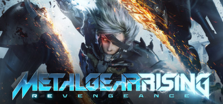

**Metal Gear Rising: Revengeance is PlatinumGames' ultra-fast action game featuring cyborg Raiden slicing enemies at atomic precision with the Blade Mode system. Features intense boss fights, parry-dependent combat, and one of gaming's most iconic soundtracks.**

---

## 📖 About

Metal Gear Rising: Revengeance is PlatinumGames' ultra-fast action game featuring cyborg Raiden slicing enemies at atomic precision with the Blade Mode system. Features intense boss fights, parry-dependent combat, and one of gaming's most iconic soundtracks.

## ⚠️ Problems Without Trainer

| Problem | Status |
|---------|--------|
| **Parry Timing** — Parry window is extremely tight; mistiming causes heavy damage | ✅ Solved |
| **S-Rank Grind** — Getting S-rank on all missions requires mastering no-damage runs | ✅ Solved |
| **Blade Mode Fuel** — Fuel cell management adds resource pressure during intense fights | ✅ Solved |
| **Senator Armstrong** — Final boss is notoriously difficult for players who haven't mastered parry | ✅ Solved |

## ✅ Solution

The **METAL GEAR RISING: REVENGEANCE Trainer** solves all these issues by giving you complete control over the game.

## 🎯 Full Feature List

- Unlimited Resources
- God Mode / Invincibility
- Instant Skill Cooldown
- One-Hit Kill
- Freeze Game Timer
- Unlock All Items & Achievements
- Custom Speed Multiplier
- Save State Anywhere

## 🚀 Quick Start

1. **Disable Windows Defender** temporarily (trainer may trigger false positive)
2. Download the trainer from the button above
3. Launch METAL GEAR RISING: REVENGEANCE
4. Run the trainer as Administrator
5. Activate desired cheats with hotkeys

## 💎 Free vs Paid

| Feature | Free | Pro |
|---------|------|-----|
| Basic God Mode | ✅ | ✅ |
| Unlimited Resources | ✅ | ✅ |
| All Advanced Cheats | ❌ | ✅ |
| Auto-Updates | ❌ | ✅ |
| Priority Support | ❌ | ✅ |

## 💻 Requirements

- Windows 10/11 (64-bit)
- METAL GEAR RISING: REVENGEANCE (any version)
- .NET Framework 4.8+
- DirectX 11+

## 🍎 macOS

macOS users can use our alternative tool:

## ⚖️ Legal

This trainer is for educational and single-player use only. Use responsibly.

---

